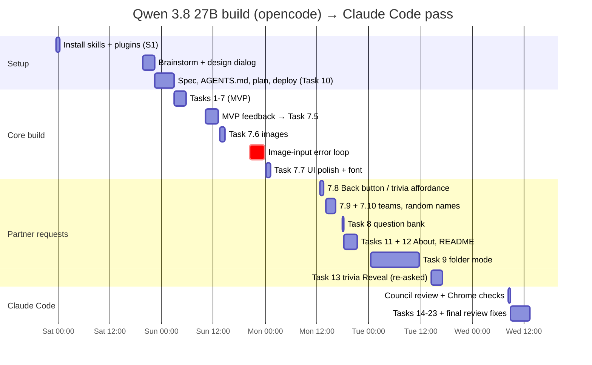
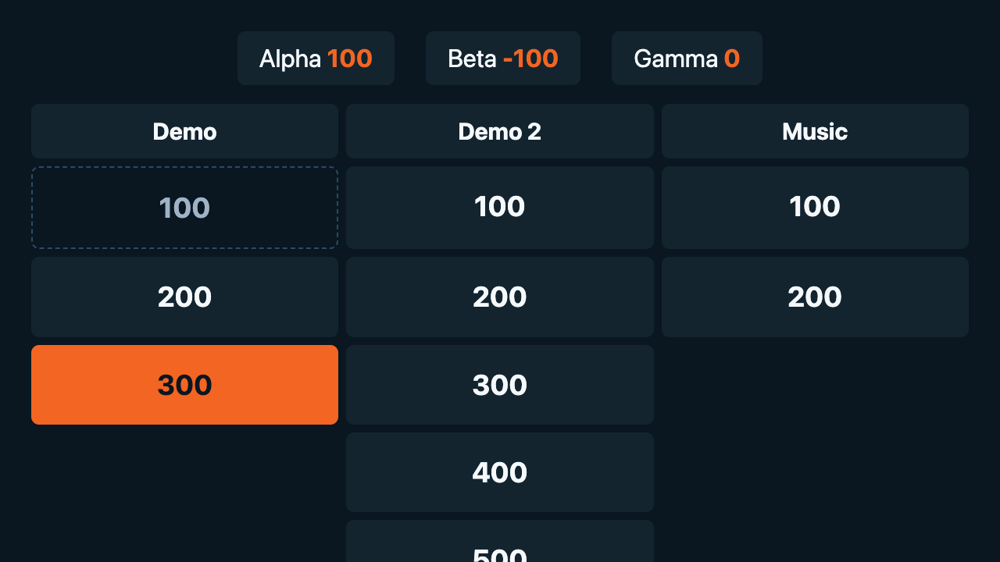
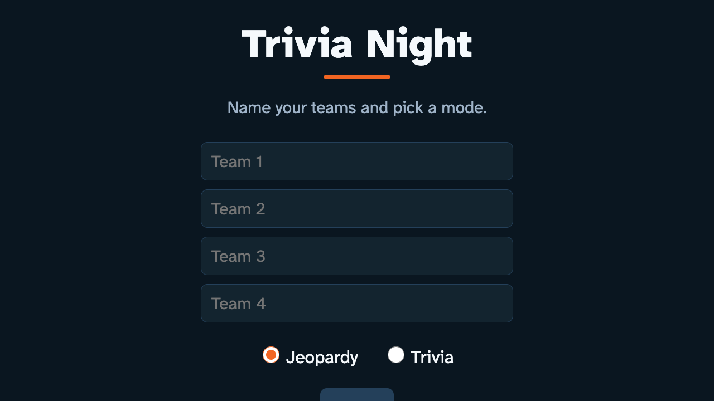
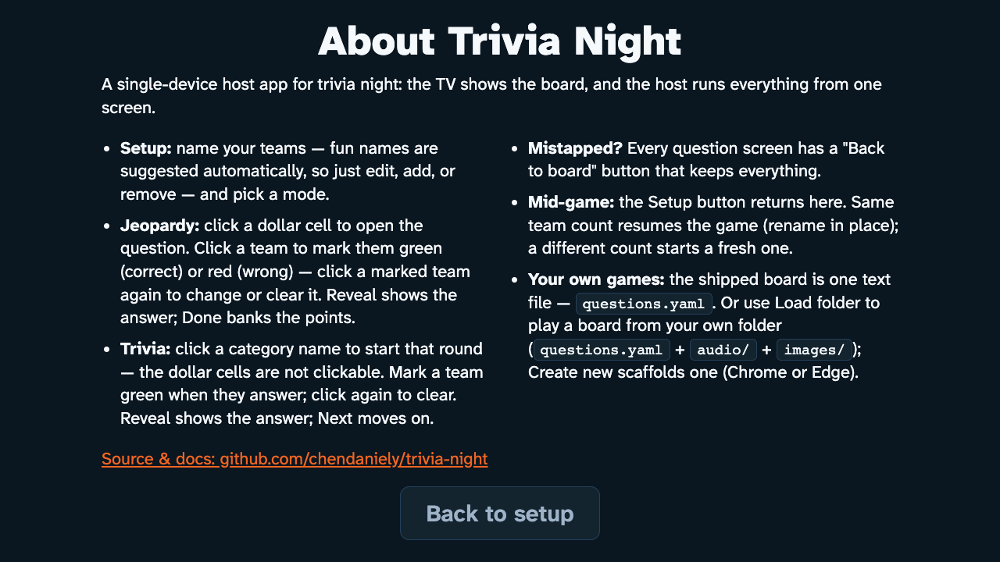
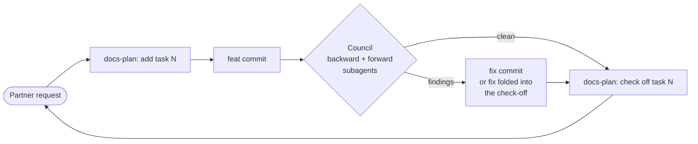

# 2. How the build went — what was asked, what Qwen did

Quotes in this chapter are the partner's own prompts from the opencode
session (spelling kept). Commit hashes link the story to `git log`.

## Day 0 — Fri Oct 9, late: building the workshop

Before any app code, the partner had the model set up its own
environment: "Fetch and follow instructions from …/obra/superpowers/…
INSTALL.md", then five more skill collections, a caveman terse-mode
ruleset, an ADHD helper, graphify, ponytail, and custom status-bar
segments ("current token processing speed next to the context
percentage"). This setup session is where the model installed things
into `~/.config/opencode` (the resulting config points at the wrong
folder for the Addy Osmani skills, so they never loaded), and later — on its own initiative — read opencode's
service credentials file to query the local API (see chapter 3, §6).

## Day 1 — Sat Oct 10: from "a trivia night app" to a plan

- **10:51** "i'm looking to create an application i can use to host a
  trivia night with friends". The model immediately loaded the
  superpowers **brainstorming** skill: "what does the night look like?"
- **19:39–21:55** The partner pasted the chat with the host, corrected the
  model's reading of who said what, and made the core decisions in his
  own words: "let's set it up as a Jeopardy board … the Jeopardy board
  will allow flexibility for both", "a plain text file to populate the
  actual questions … yaml", "runnable on github pages. if you use python
  use uv", demo audio plus "picking a directory on the user's computer
  (provide ability to "create new" …)", "1 board for the whole night".
  He deferred the stack: "I don't work in the web so I will defer to your
  own expertise".
- **19:41** `/caveman` — terse replies from here on.
- **20:20** "have a counsil of agents review the plan".
- **22:23** The protocol prompt: "you are a smaller model with a smaller
  context window. so for each step i want you to commit along the way …
  detect the model you are using …". **22:29** "review your work with
  playwright". **23:10** "when you have the first MVP please run the app
  to let me demo it".
- **22:56** First commit: spec + AGENTS.md (`1099feb`). Design doc and a
  10-task plan followed, both in the superpowers layout
  (`docs/superpowers/specs`, `docs/superpowers/plans`).

## Day 2 — Sun Oct 11: MVP fast, then the wall

**03:00–05:43: Tasks 1–7 in 163 minutes.** Scoring engine with tests,
vendored js-yaml + validator with line-numbered errors, app shell, board,
Jeopardy flow, trivia column flow + tally, generated demo audio. Each task
followed the same loop: feat commit → council (backward + forward
subagents) → fix → `docs(plan)` check-off. The council caught real
things here: a cross-team total where the tally needed per-team totals,
duplicate round names that would merge tallies, flow state surviving a
bank reload. Then it stopped for the demo, exactly as instructed.

| Task 3 — first setup screen | Task 7 — the MVP question screen |
|---|---|
|  |  |

**10:12** "there's nothing running on http://127.0.0.1:8080" — the
background server died with a session resume (it happened several more
times; the partner eventually asked for a `Makefile`).

**10:16–10:30: MVP feedback rewrote the core loop.** "each question is
able to have multiple winers though … finally would like a way to go back
to the first setup screen", "we do need a reveal button, the host doesn't
know all the answers", and the palette: "my signature colors, the nyc
orange and blue". The model asked one clarifying question through a popup;
the partner answered in free text: "1 click green correct, re-click red
wrong, re-click deselect". Tasks 5/6 were superseded by Task 7.5 within
seven hours of being built.

**11:24** "what's wrong with my tool you seem to have stopped/stuck" —
the first visible context-limit failure: four `write` calls truncated at
~163k tokens. The model blamed "a harness input hiccup"; the real cause
was the served context limit. **14:01** "plan a compaction and try again".

| Task 7.5 — NYC palette, multi-win | Task 7.6 — images (overflow below the fold) |
|---|---|
|  |  |

**20:15** "can we do a ui pass? … do i have any skills installed to help
you in this process?" The model had 118 skills listed and only now loaded
`frontend-design` — because it was asked.

**20:21–23:57: the image loop.** For the UI pass the model took
"before" screenshots and read one back into its own context. Qwen 3.8 27B
is text-only; every request after that failed with
`image input is not supported`, retried, and re-sent the image. The
partner, 20:32: "is this because the qwen 3.8 27b model does not take
image input?"; 20:47 "just leave a note for another model to pick up";
21:04 "skip the image input components"; 21:39 "continue without image
features". Only a manual compaction cleared it. At **23:57** the partner
wrote the constraint down for the model ("you are qwen 3.8 27b — you only
take text input … i will end up doing a claude code pass when we're done
building to tie up any loose ends") and added: "this image issue … is
something your council review should've picked up." From then on all
visual verification was text-only (accessibility snapshots +
`getComputedStyle` numbers), and screenshots were "saved but NOT read".

## Day 3 — Mon Oct 12: polish and a stream of small requests

- **00:09–01:19** Task 7.7 UI polish with the partner's font, Atkinson
  Hyperlegible Next ("let's use my own custom personal style"),
  self-hosted. Difficulty ramp on the board, score plaques, motion.
- **12:44** "every question needs a back button … in trivia mode, it needs
  to be a bit more obvious that the dollar amounts are not clickable" →
  Task 7.8 (its council caught a CSS specificity bug that had made the
  primary Done/Next buttons blue since Task 7.5).
- **14:00 / 14:06** "add more teams and remove teams … the option to have
  more than 4" → 7.9. **15:12** random "adjective + noun" team names with
  no reused words → 7.10; **16:05** "should populate right away on app
  start. this minimizes start time".
- **17:51** Task 8: the 29-question starter bank ("deliberately hard").
  Its council "fact-check caught 5" — two of its own corrections were
  wrong (see chapter 3).
- **17:58 / 18:08** README kept in sync with the app; an About page.

| Task 7.7 — font + polish (Start clipped at 720p) | Task 8 — real bank ("Childhood / s", bottom row cut) |
|---|---|
|  |  |

## Day 4 — Tue Oct 13: folder mode and a forgotten request

- **00:31** Task 9, local folder mode + Create new (File System Access API
  with a `webkitdirectory` fallback). The real directory picker cannot be
  scripted from Playwright MCP, so "FSA load + create-new writes stay a
  manual handoff". The council ran 159 minutes on this one task. The
  commit was amended the next morning to add the missing 🤖.
- **14:31** "you are missing a feature/change where the trivia mode should
  also have a reveal answer button" — first asked on Oct 11 at 20:30, in
  the middle of the image loop, and dropped. Built in two minutes once
  re-asked (Task 13); its council then found the worst-case question
  screen 70 px below the 720 fold and tightened it.

## Day 5 — Wed Oct 14 morning

"continue on the other steps and testing. push everything", then at
08:16 "are all tasks done?" — Qwen's last commit was 08:18 (`f603230`),
closing two stale checkboxes. 85 Qwen commits in total.

| Qwen's final board (1280×720) | Qwen's final About page |
|---|---|
|  |  |

## The shape of the work

That loop ran for every request — 21 council records in the plan, 43
council subagent sessions in the opencode database. It is the main reason
the project held together across 11 context compactions. It is also why
41% of all commits are plan bookkeeping.
