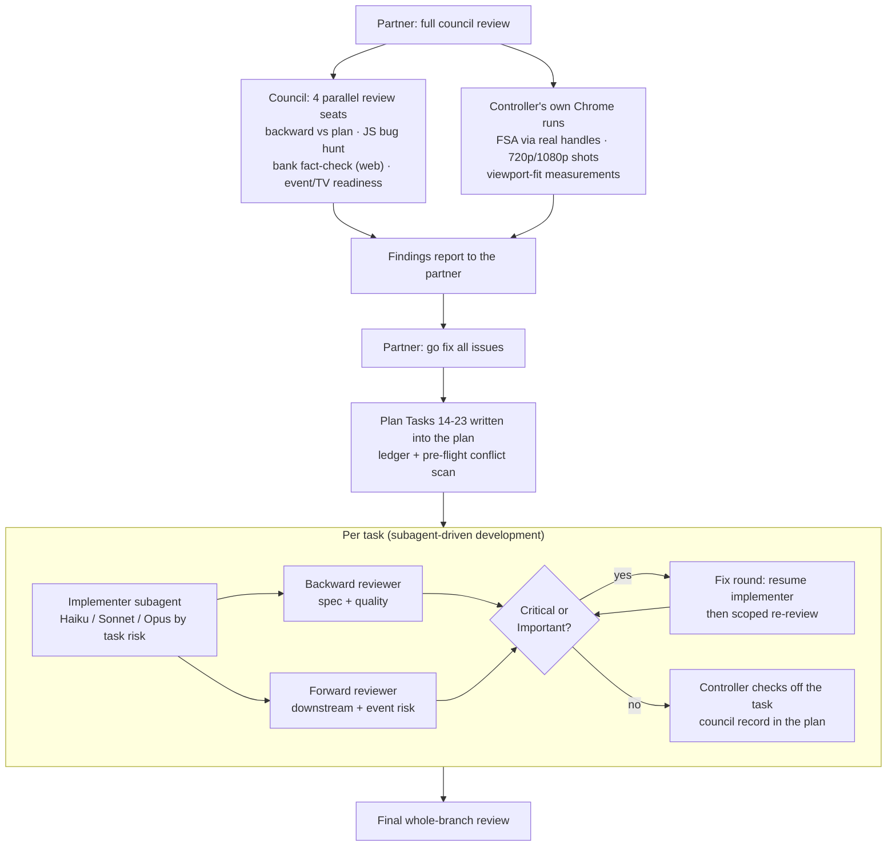

# 4. The Claude Code pass — what it found and how it was fixed

*This chapter is the separate process record the partner asked for: the
mistakes Claude found in the Qwen build, what was done about each, and the
mistakes Claude made along the way.*

## The request

On the morning of Oct 14 the partner asked Claude Code (Opus 5.5) for "a
full council review of everything", the two checks Qwen had handed off
because it could not do them (the real-browser File System Access flow, and
the visual review — "fresh screenshots, TV font/orange judgment"), and
then: "subagent go fix all issues".

## How the pass ran

The controller (Opus 5.5) wrote the task briefs, ruled on conflicts, read
screenshots and re-ran key browser checks itself; it never wrote app code.
Implementers were picked by risk: **Haiku** for the bank transcription,
**Sonnet** for most fixes and all routine reviews, **Opus** for the
saved-game design, the layout pass and the highest-risk forward review.
Every commit carries the model that wrote it.

## The council's findings on Qwen's build

Four review seats plus the controller's Chrome runs, before any fixing:

| Seat | Headline |
|---|---|
| Backward pass (vs spec + plan) | Spec/plan text stale in a dozen places; `.gitignore` would commit host photos; Create new order contradicts the plan; error screen strands the host; Reset unguarded; local server unreachable from the TV |
| JS bug hunt | Create new silently overwrites an existing folder; audio stops on re-render; remove+add team moves scores to the wrong team; error-screen dead end; misspelled keys silently ignored; inconsistent path handling |
| Bank fact-check (with web search) | **7 wrong answers, 4 invented**; 6 shaky; two errors introduced by Qwen's own Task 8 fact-check |
| Event / TV readiness | No saved state; one-press Reset; needs Chrome 86+ (blank page on older TVs); D-pad can't open questions; deploy has no test gate; deprecated action versions |
| Controller in Chrome | Create new fails if the name takes >5 s to type (real picker, reproduced); board 946 px tall (scrolls at 720p and in a windowed MacBook); image questions push controls off-screen; "Childhood / s" split |

## Every fix, with how it was verified

| # | Problem in the Qwen build | Sev. | Fix | Verified by |
|---|---|---|---|---|
| 14 | 7 wrong + 6 shaky trivia answers | 🔴 | Rewrote 13 questions with sourced answers; a forward fact-check then caught a non-unique answer in the new finale too (`c2cc6c5`, `bdf25d8`) | Independent web fact-check of all 29; state facts checked by script |
| 15 | Typos in keys silently ignored; 0-based error locations; unhelpful "must be a string" for `a: 1984` | 🟠 | Unknown-key errors with "did you mean"; `round 2 "Movies", question 3`; "put quotes around it" hints (`a91b6e7`) | node tests (RED → GREEN) |
| 16 | Create new: prompt before picker (fails after ~5 s), read-only picker, overwrote existing folders | 🔴 | Picker first with `mode: "readwrite"`, refuse existing names, trim names, clear message when edit access is denied (`66604e1`, `b87e688`) | Real Chrome: user activation still live at the picker after a 7 s prompt; existing `questions.yaml` byte-identical after a refused Create new |
| 17 | Error screen dead end; failures written to a hidden element; fallback file input unreachable from the error screen; two path normalisers; names re-rolled every board | 🟠 | Back to setup on the error screen (buttons above a capped list), visible failures, one `normPath`, percent-encoded media paths, names carried across boards, bank title in the header (`21aba93`, `b87e688`, `82ebd70`) | Chrome: bad folder mid-game → back → game intact; 45-error bank keeps both buttons on screen |
| 18 | Nothing saved; Reset unguarded; team identity by index; remote Back left the app | 🔴 | Saved game **per board** with Resume ("saved 12 min ago"), a hint when another board has a saved game, confirms on Reset / team-list change / loading a new board, setup Back to board, Back-button trap, 350 ms double-click lock (`9dc83be`, `cf26ed4`, `739d029`) | Chrome: refresh mid-game and mid-column → Resume restores scores, tallies, played cells; storage blocked → still plays |
| 19 | Clip stopped and rewound on every mark/Reveal; kept playing after leaving; light audio control | 🟠 | Media nodes built once per question; pause on every exit incl. browser Back; dark native controls (`986abf9`) | Chrome: same `<audio>` element keeps playing through a mark and Reveal |
| 20 | Board overflowed 720p and windowed laptops; header split mid-word; image questions off-screen; nothing scaled | 🟠 | Viewport-unit layout; image beside text; text questions grow to fill the screen (`aff3d63`, `c3af70b`, `e9a092c`) | 192 of 198 fit checks across 960×540 … 1920×1080 (the 6 are the error screen, which scrolls by design) |
| 21 | Cells/headers were `
`s — no remote/keyboard; focus lost on every re-render | 🟠 | Real buttons, visible focus ring, focus restored (never onto Done/Next) (`7a8cb84`) | Keyboard-only run through both modes in Chrome |
| 22 | Host photos committable; server unreachable from the TV; deploy ungated on deprecated actions; blank page on old TV browsers; **LAN server exposed the whole repo** | 🟠 | `images/*` ignored; `uv run` server with `make serve-lan`; deploy gated on tests + bank validation with current action majors; boot note + polyfill; server allowlist (`6d1aa38` … `dc242ce`) | curl matrix: 8 app paths 200, every probe (`.git`, drafts, traversal, double-encoding) 404 |
| 23 | Spec/plan/README/About stale; no host checklists | 🟡 | Reconciled; README gained "Before the night" and "On the night, if…" lists, and safe wording for where real questions live (`39b9be6` … `c0e217c`) | Every claim traced to code by the backward reviewer |
| Final | Held remote OK beat the click lock; other-board hint hidden; boot note vs reduced motion; dead CSS; no tracked smoke test | 🟠 | One fix wave + a tracked `make smoke` Chrome test | Final reviewer's scripted game night + scoped re-review |

## What Claude got wrong along the way

The partner asked for an honest record, so here are the Claude pass's own
mistakes, all caught by its reviewers or by the controller reading a
screenshot:

1. **The first saved-game design had a critical hole** (Task 18, Opus
   implementer, approved by the backward reviewer). It used one save slot.
   The forward reviewer (also Opus) worked out that the real night runs on
   *folder* boards: after a refresh the app loads the shipped board, offers
   no Resume, and pressing Start overwrote the folder game's save. It
   reproduced this in Chrome. Fixed with one slot per board plus a hint.
2. **My error-list fix didn't fit 720p** (Task 17). I ruled "cap the list
   at 12 errors" to keep the buttons reachable; the implementer measured
   that 12 wrapped messages still pushed them off a 720p screen. The
   reviewer pointed out that a count cap can't bound height at all. Fixed
   by moving the buttons above the list.
3. **My layout ruling shrank the question text** (Task 20). To make 960×540
   fit I asked for proportional scaling; at 720p the question dropped from
   52 px to 35 px with half the screen empty. I caught it reading the
   screenshot and ordered a second round: text questions now fill the
   screen (58 px at 720p, 80 px at 1080p).
4. **A security hole introduced by a Claude fix.** Task 22's `make
   serve-lan` (my plan) let anyone on the party Wi-Fi browse the repo —
   `.git` history and the real `question-drafts/`. An automated commit
   security review and the forward reviewer both flagged it; fixed with an
   allowlist before the task closed.
5. **A plan-mandated answer that wasn't unique.** My own Task 14 bank text
   used "facetious or abstemious" for the five-vowels question; the
   forward fact-check found rarer valid answers. Amended.
6. **Gaps the final whole-branch review found in Claude's own fixes.**
   An Opus reviewer ran a scripted game night in Chrome across the whole
   branch and found that a *held* OK/Enter on a remote got past the
   350 ms double-click lock (Task 18) and the focus rules (Task 21) — the
   key repeats marked a team or opened the next question; that the
   other-board hint (Task 18) disappeared whenever the shipped board had
   an older practice save; and that the old-browser note (Task 22) never
   appeared for users with reduced motion. All three were fixed in one
   final wave before merge.
7. **Smaller things:** a dispatch prompt with a half-edited sentence in it
   (Task 18), a reviewer's false alarm about a commit trailer, and several
   reviewers marking things "cannot verify from the diff" that the
   controller then re-ran in Chrome (Tasks 16, 18, 19, 21).

The difference from the Qwen run is not that Claude made no mistakes — it
made several — but that a forward reviewer with real-browser access and
better world knowledge caught each one before the task closed.

## Numbers

| | Qwen build | Claude pass |
|---|---|---|
| Commits | 85 | 42 for the fixes (Opus 17 · Sonnet 23 · Haiku 2), plus this write-up (`435d135`, Opus) |
| Wall time | ~4 days (with sleep) | review in the morning, fixes 08:44–13:19, then this write-up |
| Test files / assertions | 4 / 70 | 5 / 214, plus a tracked Chrome smoke test |
| Tested DOM behaviour | accessibility snapshots + computed styles | Chrome scripts per task; `make smoke` committed |
| Bank answers wrong | 7 / 29 | 0 / 29 after two independent checks |

## Outcome

The branch merged into `main` as
[PR #1](https://github.com/chendaniely/trivia-night/pull/1) (merge commit
`e9ccb0b`, Oct 14 16:25) with a merge commit, so every per-step commit
survives. The deploy that the merge triggered ran the new gate (unit tests
5/5, bank validation 6 rounds / 29 questions) and published to Pages;
`make smoke` then passed against the live URL, held-Enter check included.
What is left needs real hardware: the TV font, the 30-second real-picker
check, the friend's TV, two trackpad swipe-backs, and `make serve` once on
the event Mac (plan, Deferred items 3–7).
