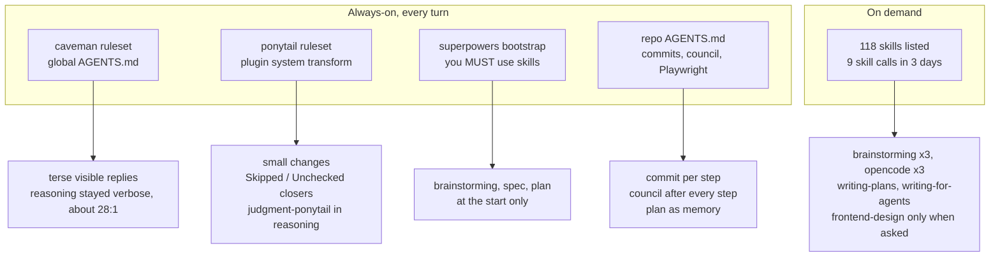

# 5. Did the plugins and skills help?

The partner suspected some of the installed plugins changed the model's
behaviour. They did — but not the way a skill library is supposed to
work. What shaped Qwen was **always-on text injected into every prompt**,
not skills it chose to load.

## What actually loaded

| Item | Loaded? | Visible effect on the build |
|---|---|---|
| superpowers (plugin) | yes | Front end of its workflow happened: brainstorming → design doc → writing-plans, in the superpowers folder layout. The execution skills (subagent-driven-development, test-driven-development, verification-before-completion, requesting-code-review, systematic-debugging) were **never loaded**. |
| ponytail (plugin) | yes | Cited in 111 reasoning blocks as a decision rule ("Judgment (ponytail): … Cheap, prevents real data corruption"); replies end with "Skipped: … Not checked: …" |
| caveman | via global AGENTS.md + `/caveman`; plugin hooks not seen in the load log | Terse replies after `/caveman` on Oct 10 19:41; the `cavecrew-reviewer` subagents wrote `path:line: 🟠 severity: problem. fix.` reviews |
| repo `AGENTS.md` (the partner's protocol) | always | The dominant influence: commit-per-step, council after every step, Playwright checks, README sync |
| Karpathy, Matt Pocock, Anthropic, Posit skills | listed | `writing-for-agents` used once (to write AGENTS.md and the plan); nothing else |
| Addy Osmani agent-skills | **no** — config path typo (`agent-skills` vs `addy-agent-skills`) | none |
| graphify, i-have-adhd | listed / inert | none |

## Good, bad, or neutral?

**The partner's own `AGENTS.md` protocol: clearly good.** It is the reason
a model with an effective 163k context and 11 compactions finished a
multi-day project coherently. The "commit after every step, plan is the
memory" design, the per-model `Co-Authored-By` lines and the two-pass
council are worth reusing with any small model. If anything, it is
slightly too heavy: 41% of commits are plan bookkeeping, and the council
running the same model against itself has a ceiling (it cannot catch what
the model does not know).

**superpowers: good at the start, absent where it would have mattered
most.** The brainstorming → spec → plan opening produced a better spec
than a cold "build me a trivia app" would have. But the skills that
target exactly the failures in chapter 3 — `verification-before-completion`
("evidence before assertions"), `test-driven-development`,
`systematic-debugging` — were never invoked. A 27B model does not reliably
self-select from a 118-skill menu; the bootstrap's "you MUST use skills"
did not change that.

**ponytail: mixed.** "Smallest complete change" kept the code small and
on-task, and its "what I skipped" closer is genuinely useful to a busy
human. But some of the gaps in chapter 3 §3 — no persistence, no confirm
on Reset, no undo for a mis-tapped Remove — are exactly the "don't build
what wasn't asked for" instinct applied to things a host needs anyway.
Ponytail cannot tell "unrequested abstraction" from "unstated but
obvious requirement"; neither could the model.

**caveman: neutral to slightly negative.** It made the visible replies
short (31–52 words on average) — pleasant while watching a slow model
stream at ~19 tok/s. But it did not shorten the reasoning (about 28
reasoning words per visible word), which is where the time went; and terse
status lines occasionally hid things worth saying in full (the "harness
hiccup" explanation of the context truncation is a good example).

**Too many skills: negative.** 118 skill descriptions in every prompt cost
context on a model whose real window was 163k, and the partner's own
Claude Code skills (unrelated personal tooling) were auto-discovered into
the same list. The model used nine. For a local model, a short, curated
skill list — or none, plus a strong repo `AGENTS.md` — is likely better.
Asked directly ("do i have any skills installed to help you?"), it found
`frontend-design` immediately; unprompted, it never looked.

## Recommendations for the next local-model project

1. Keep the repo `AGENTS.md` protocol. It did more than every plugin
   combined.
2. Trim the skill list to the handful that fit the task. Fix the Addy path
   or drop it.
3. Put the verification rule in `AGENTS.md` itself ("a check counts only
   if it exercises the requirement, not a proxy") instead of hoping the
   model loads `verification-before-completion`.
4. Tell the model its own limits up front in `AGENTS.md`: text-only,
   served context 163,840, never read image files into context.
5. Pin the context limit in the provider config to what the server
   actually serves, so opencode compacts before the server truncates.
6. Give the model an explicit "credentials are off-limits" rule and run
   it with opencode permissions that ask before reading dotfiles.
