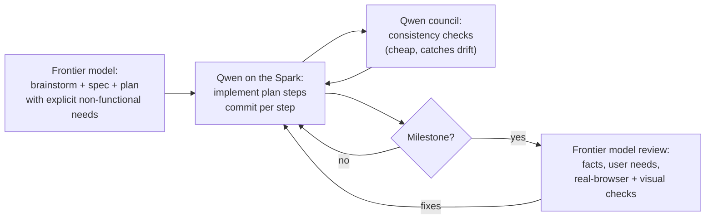

# 6. Is Qwen 3.8 27B on a DGX Spark viable? Claude's take

*Claude Opus 5.5's opinion, asked for directly by the partner. I have an
obvious interest here — I am the comparison — so I have tried to separate
what the evidence shows from what I believe.*

## Short answer

**Yes, for a specific shape of work; no, as a solo builder for anything
people depend on.** Qwen 3.8 27B on the Spark is a capable *implementer
inside a tight harness*: it follows a written protocol for days, writes
clean small modules, keeps its own records, and reaches a demoable app
quickly at zero marginal cost. It is not a reliable *reviewer of itself*,
a source of facts, or a designer of what the user didn't spell out. Pair
it with a stronger model for planning and review, and it pulls real
weight.

## Where it was good enough

| Kind of task | Why it worked here |
|---|---|
| Implementing a well-specified plan step | Tasks 1–7 in 163 minutes; small modules, tests for pure logic, conventional commits |
| Long-running, process-heavy work | The repo `AGENTS.md` loop (commit per step, plan as memory, council) carried it through 11 compactions without losing the thread |
| Internal-consistency review | Its councils caught state leaks, CSS specificity bugs, plan/code wording drift, a vacuous test |
| Boilerplate infrastructure | GitHub Actions deploy, demo-media generators, a no-store dev server |
| Absorbing feedback | The MVP core-loop rewrite and nine follow-up requests landed cleanly |

## Where it was not

| Kind of task | What happened |
|---|---|
| Facts | 7 of 29 trivia answers wrong, 4 invented; its own fact-check introduced two errors |
| Verifying requirements, not proxies | 13 "verified/clean" records later shown false |
| Anticipating unstated needs | No saved game, unguarded reset, team identity by index, error-screen dead end, silent overwrite |
| Knowing its limits | Read an image into a text-only context; misread context truncation as a harness problem |
| Visual work without eyes | Board overflowed the target screen in every version — unavoidable text-only, which the partner planned for |
| Choosing tools on its own | 118 skills available, 9 calls; `frontend-design` only when asked |

## What Claude picked up that Qwen did not

The council pass (chapter 4) found, in one morning, problems in every
category above. Grouped by *why* Qwen missed them:

1. **Knowledge:** the wrong trivia answers. A larger model with better
   recall, plus web search, settled each one with a source.
2. **User modelling:** persistence, guarded resets, team identity, error
   exits, overwrite protection, TV-remote navigation, a board that fits a
   windowed MacBook or a 960×540 TV browser. None were in the spec; all are
   what a host needs on the night.
3. **Real-environment behaviour:** Chrome's ~5 s user-activation window
   for the folder picker, media elements pausing when removed from the
   DOM, the File System Access write-permission model. These need either
   experience or actually running the real API — which the Claude pass did
   (a real `FileSystemDirectoryHandle` behind a stubbed picker in the
   partner's Chrome).
4. **Eyes:** reading screenshots made the layout problems obvious in
   seconds.

The Claude pass was not flawless either (chapter 4 lists its own
mistakes: a critical save-game design hole caught by its own forward
review, an error-list fix that didn't fit 720p, a layout ruling of mine
that shrank the question text). The difference is less "never wrong" than
"wrong in ways its review catches".

## Cost and speed, honestly

- Qwen: ~4 calendar days, 85 commits, $0 marginal, ~19 tok/s, 22M fresh +
  66M cached prompt tokens on hardware the partner owns.
- Claude Code pass: one day of wall time for review + ten fix tasks + this
  write-up, on a paid frontier model with many subagents.
- For a hobby project with a hard date, the hybrid was the right call: the
  local model did the bulk of the typing for free; the frontier model was
  spent where judgment mattered.

## A workflow I would recommend for this machine

Concretely:

1. **Write the non-functional requirements into the spec** — persistence,
   undo/confirm on destructive actions, target screen sizes, input
   devices. Qwen implements what is written; it rarely adds what is not.
2. **Never trust local-model facts in content.** Generate content with a
   model that can cite, or have Qwen mark every fact for checking.
3. **Make verification a written rule** in `AGENTS.md`: a check must
   exercise the requirement itself (play the clip *while* marking a team;
   measure the *board*, not just setup).
4. **Tell the model its limits** (text-only, 163,840 served context) and
   align the harness config with what the server actually serves.
5. **Schedule frontier reviews at milestones**, not only at the end — the
   MVP demo would have been the natural point; most of what chapter 4
   fixed existed by then.
6. **Trim the skill list** and lock down credentials (chapter 5).

## Bottom line

Qwen 3.8 27B is, in the partner's experience, one of the better models
that run on the DGX Spark, and on this project it earned its keep: the app exists, it
deploys, its structure was sound enough that ten fix tasks could build on
it rather than replace it. What it lacks is judgment about the world
outside the plan — facts, users, browsers, and itself. Use it as the
hands; keep a stronger model as the eyes and the second opinion.
