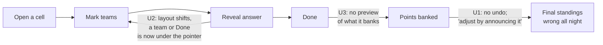
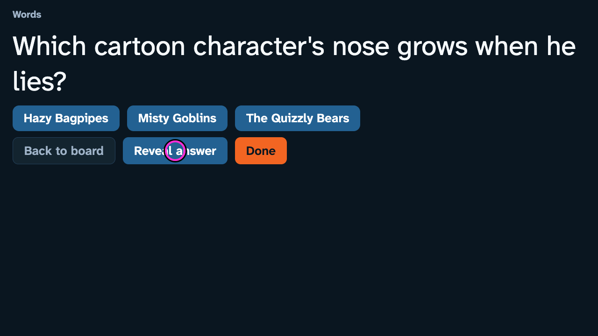
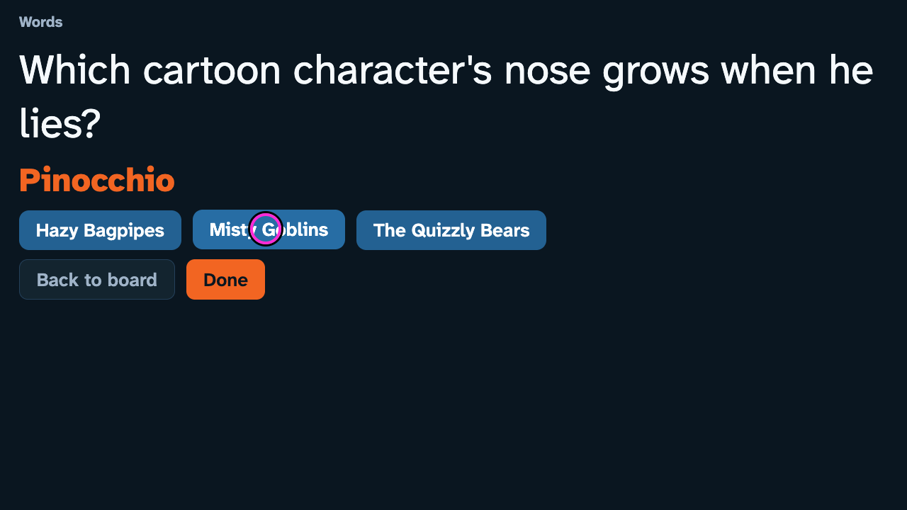
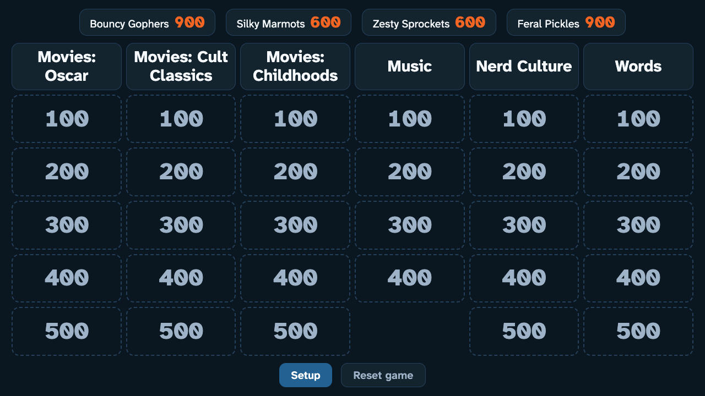
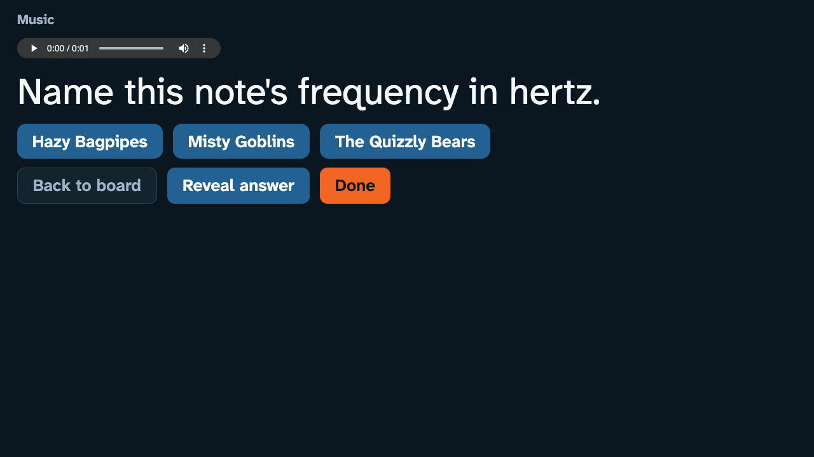
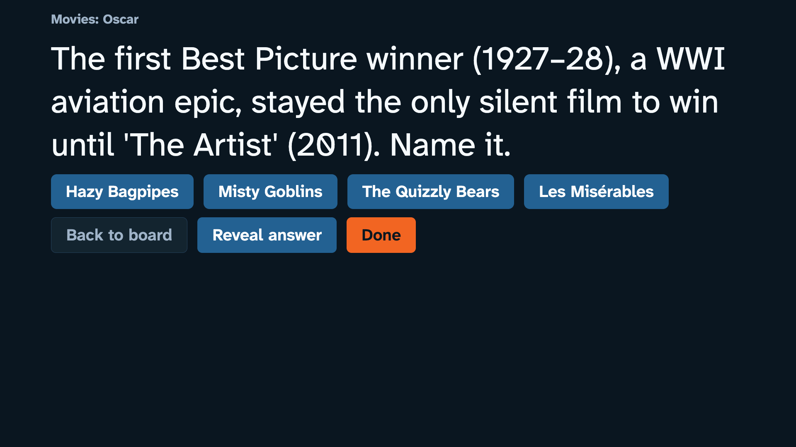
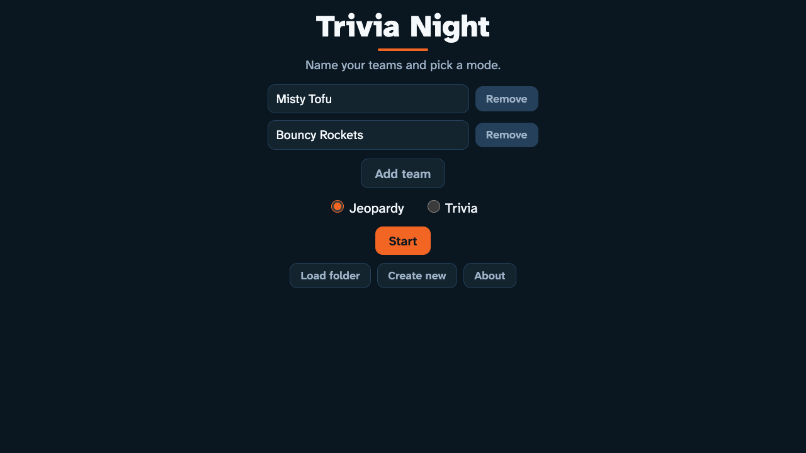
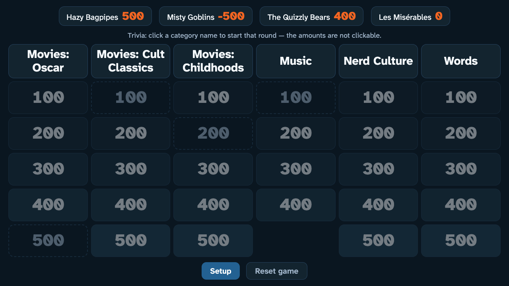
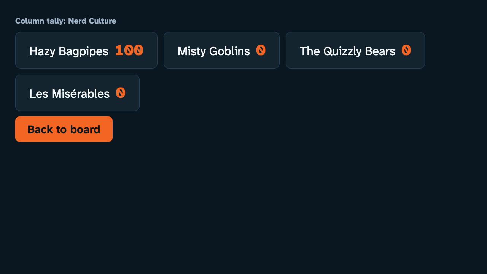
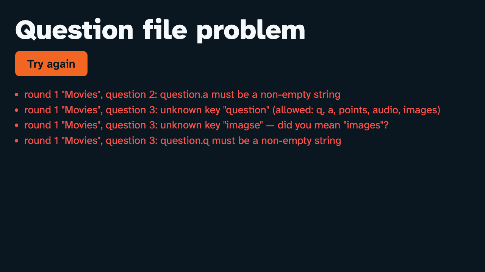

# 8. UX audit: what both passes missed

*A living chapter. It opens with the audit, made on Oct 14 after the
merge and before any UX change, and checked by a two-seat council. As
fixes land, the **Status** column in the tracker and the
[Fix log](#fix-log) are updated. Status as of Oct 15, early morning:
Batch 1 (scores you can trust) fixed on the branch, not merged yet. The app as the audit found it is release
`v0.2.0`; the release after these fixes will be `v1.0.0`.*

## The request

After the merge, the partner asked whether Claude had "any skills for
looking and making good UI? UX?". Then:

> yeah let's keep these in mind. and first do a UX audit. this repo also
> has a docs/case-study let's also keep track of some of the changes we
> are goign to be making (start a new chapter) that the qwen3.8 27b model
> may have missed.

## How the audit was done

- **Skills.** `ui-ux-pro-max` supplied its rule database and its order of
  priority: accessibility, interaction, layout, then type and color.
  `taste-skill:redesign-existing-projects` supplied an audit-first
  checklist. `external-app-review` set the format of this folder. Many
  checklist items are for marketing sites and were skipped as not
  applicable: legal links, cookie banners, skip links, 404 pages,
  hover-lift effects.
- **A real browser.** Playwright drove Chrome through 15 screens at four
  sizes: 1920×1080, 1280×720, 960×540, and 1440×900 (a 16:10 Mac window
  mirrored to the TV). It added keyboard-only, six-team and phone runs,
  for 68 screenshots in all. Each one recorded overflow and the computed
  type sizes.
- **Probes.** Four checks went beyond screenshots. The first clicked
  Reveal at the button's own coordinates and recorded what sat under the
  pointer afterwards. The second measured the empty space under each
  question. The third played the whole board to the end. The fourth
  cleared a team name. Separately, WCAG contrast was computed for 16
  color pairs. Raw numbers are in
  [research/ux-audit-measurements.md](research/ux-audit-measurements.md).
- **Council.** Following AGENTS.md, two reviewers checked the draft
  before it was committed. A backward reviewer (Sonnet 5.5) re-derived
  about 75 claims from the code, git history and screenshots. A forward
  reviewer (Opus 5.5) looked for downstream risk in the proposed fixes
  and measured, in Chrome, how much screen space each fix would cost.
  Their corrections are folded in below, and the
  [audit's own mistakes](#what-this-audit-got-wrong) are listed.
- **The lens.** One screen serves two audiences. *The room* reads the
  board, the question, the answer and the scores from about 10 ft away.
  *The host* runs the game with a mouse or a remote while everyone
  watches, and sometimes nobody knows the answer.

## What already works

Credit first. Most of these came from Claude's earlier pass (Tasks 18–21).
The visual identity and the ✓ / ✕ marks are Qwen's.

1. **Every screen fits.** All screens fit the screen at all four sizes,
   with little room to spare in the worst case (see U9). The only
   exception is the error screen at 960×540, which scrolls by 2 px.
2. **Contrast mostly passes.** Every text pair on the Jeopardy screens
   meets WCAG AA. The lowest are muted-on-edge at 4.99:1 (the disabled
   Start button) and orange on a score pill at 5.04:1. Body text is
   17.3:1. The exception is the trivia board: dimmed cells are 3.96:1
   and played cells 2.70:1 (U14).
3. **Marks don't rely on color.** Green and red are only 1.32:1 apart,
   which looks the same to a red-green color-blind viewer. The ✓ / ✕
   suffixes (`05fcb4d`, Qwen) carry the meaning.
4. **Remote control works in Chrome.** Focus is visible, the D-pad
   navigates, and focus never lands on Done or Next. U19 covers older
   browsers.
5. **Type sizes suit a TV.** The question is 58 px at 720p and 80 px at
   1080p. Board values are 43 px and 64 px. Scores use tabular figures.
   The typeface was chosen for legibility.
6. **Guards are in place.** Destructive actions ask first, and browser
   Back never leaves a running game.

## The tracker

Severity: 🔴 can leave the final scores wrong or strand the host ·
🟠 hurts the room's experience or slows the host · 🟡 polish.
"Origin" is the commit, found with `git blame`, that introduced the
behavior.

| # | Finding | Sev. | Origin | Status |
|---|---|---|---|---|
| U1 | A banked score can't be corrected | 🔴 | Qwen `05fcb4d` (Done), spec | fixed `9c417d1` |
| U2 | Screens change under the pointer, so a second click hits a different button | 🔴 | Qwen `05fcb4d`; Claude `cf26ed4` patched the symptom | part 1 (guard) fixed `9c417d1`; part 2 (layout) in Batch 2 |
| U3 | Done doesn't show what it will bank | 🟠 | Qwen `05fcb4d` | fixed `9c417d1` |
| U4 | The question screen hides what it's worth | 🟠 | Qwen `05fcb4d` | open |
| U5 | Score changes are silent | 🟠 | Qwen `c0aa8b8` | open |
| U6 | The game has no ending, and the scoreboard is the smallest thing on the board | 🟠 | Qwen `c0aa8b8`, spec | needs the partner's call |
| U7 | Native `confirm()` / `prompt()` dialogs | 🟠 | Claude `cf26ed4` (confirms); Qwen `35e2b32` (prompt) | fixed `9c417d1` |
| U8 | The music clip uses the browser's small player | 🟠 | Qwen `d8eb078` | open |
| U9 | Questions hug the top of the screen | 🟡 | Qwen's layout; Claude `e9a092c` kept it | open |
| U10 | The answer is smaller than the question, with no label | 🟡 | Qwen `05fcb4d` | open |
| U11 | Disabled buttons look more clickable than enabled ones | 🟡 | Qwen `1630f28` | fixed `9c417d1` |
| U12 | Start is disabled with no reason given | 🟡 | Qwen `add404e` | open |
| U13 | Setup doesn't explain the two modes | 🟡 | Qwen `870b49a` | open |
| U14 | On the trivia board, played and unplayed cells look alike | 🟡 | Qwen `38bcbf4` | open |
| U15 | The column tally is a bare list | 🟡 | Qwen `127ee57` | open |
| U16 | Error messages use schema language | 🟡 | Qwen; Claude `a91b6e7` improved the locator | open |
| U17 | Negative scores look like positive ones | 🟡 | Qwen `c0aa8b8` | open |
| U18 | Focus is lost when the game ends | 🟡 | Claude Sonnet `7a8cb84` | open |
| U19 | Older TV browsers lose the focus ring and cell highlight | 🟡 | Qwen `1630f28`; Claude Sonnet `7a8cb84` | open |

U2 and U3 let a wrong score through, and U1 means it then stays wrong
for the rest of the night:

## The findings

### U1 🔴 A banked score can't be corrected

After **Done**, points are banked and the cell closes. The README tells
the host to "adjust by announcing it". From then on the board's
scoreboard, which by spec is the final standings, is wrong for the rest
of the night. A mis-tap, a disputed answer or a late "actually, we said
Capra" can't be fixed. This hits the spec's own anti-goal: "a click does
something ambiguous".

**Fix:** an **Undo last question** button on the board. It reverses the
most recently banked cell (its points and its played state), is saved
with the game, and asks first. The forward review showed that the
scoring code can't do this as it stands. Its log is grouped by round
name and has no question id, and a Done with no marks, or a trivia pass,
writes no entry at all. So the fix needs:

- an explicit one-level record, `{ cell, round, deltas }`. Reset and a
  new game clear it, and it is saved and restored with the game.
- undo to remove exactly those entries, so trivia column tallies stay
  right.
- the save format to stay `v: 1`, with the record as an optional field.
  A bad record drops only that field. Bumping the version would throw
  away every existing save, including a game in progress when Pages
  redeploys.
- one function that turns marks into deltas, shared by Done, Next, the
  U3 preview, this record and the U5 badge.

The Undo button stays in place, disabled, after use, so Reset never
slides under the pointer (see U11 for the disabled style). After an
undo, focus goes to the reopened cell. The draft's second option,
adjusting scores from setup, is dropped: number inputs are awkward on a
remote, and logging an adjustment under a real round would skew that
round's tally.

### U2 🔴 Screens change under the pointer, so a second click hits a different button

| Pointer on Reveal | Same pointer after the click |
|---|---|
|  |  |

On a text question, revealing inserts the answer *above* the team
buttons, so the team row and the controls drop 72 px at 720p and 100 px
at 1080p. The Reveal button disappears, and Done slides into its place.
The probe clicked Reveal at its center and then read what was under that
point. At both sizes probed (720p and 1080p) and on all three questions
tried, it was the **second team's button**. A host who clicks again, for
example because nothing seemed to happen, marks that team correct.

The forward reviewer found the same problem at other transitions, and
some of them are worse:

| After this click | This is under the pointer | Re-checked |
|---|---|---|
| Reveal, on an image question | **Done**, which banks the question | yes, 720p and 1080p |
| Opening cell "Childhoods 300" | **Done**, which closes it at zero | yes, 720p |
| Reveal then Next, in trivia (later questions) | the next question's **Reveal** | reviewer's probe |
| Next, in trivia | the next question's **Next**, which passes it | reviewer's probe |
| Done, or the tally's Back to board | a playable cell or a live column header | reviewer's probe |

With U1, a stray Done can't be taken back. That is why U2 is 🔴.

Claude's pass added a 350 ms click lock (`cf26ed4`). It catches a fast
double-click, but not a second click a moment later. It treats the
symptom; the layout still moves.

**Fix**, in two parts:

1. **A same-spot guard first.** After any click that changes or redraws
   the screen, ignore real clicks within about 10 px of it until the
   pointer moves. It goes in the existing capture listener next to the
   lock, and keeps the lock and the held-Enter swallow. A tracked probe
   covers every transition in the table above. This removes the danger
   without touching the layout.
2. **Then stop the layout moving.** Render the real answer with
   `visibility: hidden` before Reveal, so its space is reserved exactly
   (a fixed minimum height is only a guess). Replace Reveal with a
   non-interactive placeholder of the same size. It has no focus key,
   so focus still goes to the first team button after Reveal. The forward
   reviewer found that a disabled "Answer shown" button that kept the
   key would strand a remote host with focus on nothing. Make the same
   change in trivia mode.

This follows ui-ux-pro-max's *Content Jumping* rule (High): "reserve
space for async content".

### U3 🟠 Done doesn't show what it will bank

Done applies every mark at once. Green is plus the cell's points, red is
minus, and no marks means nobody scores. Nothing on screen shows the
result before it becomes permanent. **Fix:** a fixed-height line
*below* the team buttons that updates as marks change, such as
"Banks: Hazy Bagpipes +500 · Misty Goblins −500" or "No one scores". It
must never change height, because a line that grows as marks are added
would itself move buttons under the pointer (U2).

### U4 🟠 The question screen hides what it's worth

A Jeopardy question shows only its category, in muted grey at 21 px at
720p. That's the smallest text on the screen. The point value is not
shown at all. In Jeopardy mode a wrong answer *costs* points, so teams
need the stakes before they answer. **Fix:** a one-line header such as
"Movies: Oscar · 500" at TV size, shortening a long round name with an
ellipsis rather than wrapping. In trivia mode:
"Nerd Culture · question 2 of 5 · 200".

### U5 🟠 Score changes are silent

After Done, the board redraws with new numbers. Nothing shows which
teams changed or by how much, which is exactly what the room looks up
to see. **Fix:** a "+500" / "−500" badge on each changed score pill,
read from U1's record. It is positioned so it can't move anything,
because inline text would wrap the scoreboard onto a second row and
shift the grid. It fades in within 240 ms and stays until the next
screen change. Under reduced motion it appears without the fade, so the
information isn't lost. In trivia mode it shows after the column tally.
This follows ui-ux-pro-max's *Success Feedback* rule.

### U6 🟠 The game has no ending, and the scoreboard is the smallest thing on the board

When the last cell is played, the board turns into dashed cells and
nothing else happens. The probe game ended in a **900–900 tie** that
nothing on screen mentions. During play, the scoreboard is the smallest
text on the board: team names are 20 px at 720p, against 29 px for
category headers and 43 px for point values. Nothing marks the leader.

The spec says "No separate final-scoreboard screen: the board's
scoreboard is it", so this needs the partner's call. A fix that fits the
spec: once no playable cells remain, the scoreboard becomes **Final
scores**. Teams are ranked, the leader is highlighted, ties are shown as
ties, and the type is larger. "Final" is worked out from the played
cells each time the board is drawn, so Undo, Resume and Reset all just
work. It has to fit six teams at 960×540, where the board has only 50 px
to spare. A lighter option is to mark the leader during play as well.

### U7 🟠 Native `confirm()` / `prompt()` dialogs

Four confirms (Reset, discarding a saved game, changing the team list,
loading another board) and one `prompt()` (Create new) use the
browser's own dialogs. On the TV they look foreign. The README itself
warns that "some TV browsers suppress dialogs". A suppressed `confirm()`
returns false, so on the TV-browser routes the host could never reset,
never start over a saved game, never change the team list mid-game and
never load another board. The recommended mirroring route is fine.
Claude's pass added all four confirms (`cf26ed4`).

**Fix:** a confirm screen in the app's own style. It is built as one
more screen rather than an overlay, because `<dialog>` and `inert`
postdate the README's browser floor, and a TV remote's D-pad ignores
focus traps:

- Focus starts on Cancel, and Cancel returns focus to the button that
  opened it.
- The remote's Back means Cancel. Enter presses only the focused button.
- Esc needs a key handler, which is an explicit exception to Task 21's
  "no key handlers" ruling.
- OK must not sit where Reset, Undo or Done sat (U2).
- **Load folder** must open the picker straight from OK's click, while
  the browser still counts it as a user action.
- **Create new** shows its name field before the picker opens. That
  reverses Task 16's "picker first", whose verification note changes
  with it.
- In the same commit, `make smoke` clicks the confirm screen and fails
  on any native dialog. The README's "Test on the actual TV" list and
  deferred item 5 are rewritten.

### U8 🟠 The music clip uses the browser's small player

The clip control is Chrome's native player: 320 × 32 px at 720p, at the
top left, with a play button the size of a grain of rice. A code comment
(`question.js`) notes that focus on it "is simply lost" when the screen
redraws. A music round is planned.

**Fix:** a large **▶ Play clip** / **❚❚ Pause** / **↺ Replay** button
in the controls row, with the native element kept for its progress bar.
The button has a fixed width, because labels of different widths would
slide neighbors under the pointer, and it doesn't sit next to Reveal. It
is built and cached with the clip, so its state survives redraws. If the
clip fails to load, the button is removed and focus goes to the first
team. A rejected `play()` is caught, because `make smoke` fails on
console errors.

### U9 🟡 Questions hug the top of the screen

On text-only questions, the space left empty under the controls is
39–46% for Wings (a long question) and 50–56% for a short one, before
Reveal. The question, the answer, the host's team buttons and the
controls are stacked tightly at the top.

That empty space is not spare space. The type is sized for the worst
case: the longest question (Oscar 300, 162 characters), revealed, with
four long team names. There the forward reviewer measured only 87 px to
spare at 960×540 and 129 px at 720p, and 33 px and 57 px with six teams.
U3, U4 and U10 together would overflow with six teams at every size.

**Fix:** center the question and answer in the space above, and pin the
team buttons and controls to a bottom band. That also separates what
the room reads from what the host presses. Do this with a grid that has
a flexible slack row, as the image layout already does, not with fixed
positioning, which would overlap the answer in the worst case. Move Back
to board last in the *page* order, not with CSS `order`, so the Tab
order and the D-pad agree. Retune the question size once, after U2, U3,
U4 and U10 are all in place.

### U10 🟡 The answer is smaller than the question, with no label

The answer is the payoff, but it shows at 0.8× the question's size (47
against 58 px at 720p), in orange, with no label. **Fix:** an inline
"Answer:" prefix, which costs no extra line (a separate label line
would cost 50–86 px), and a size closer to the question's. Its space is
reserved, as in U2.

### U11 🟡 Disabled buttons look more clickable than enabled ones

With two teams, both **Remove** buttons are disabled. Disabled buttons
get a filled blue-grey background, while enabled quiet buttons are dark
with an outline. So the two disabled Removes look like the real buttons,
and **Add team** looks switched off. The disabled Start looks like the
board's Setup button. **Fix:** draw a disabled button in its own style
at reduced opacity (ui-ux-pro-max *disabled-states*: 0.38–0.5), or hide
Remove at the two-team minimum. This comes before U1's disabled Undo
button.

### U12 🟡 Start is disabled with no reason given

Clearing a team name disables Start, and nothing on screen says why.
**Fix:** "Every team needs a name" beside Start, or accept the blank and
use the placeholder name.

### U13 🟡 Setup doesn't explain the two modes

"Jeopardy" and "Trivia" are bare radio buttons. The difference is only
explained on the About screen. **Fix:** one line under each, such as
"pick any cell; wrong answers lose points" and "play a category top to
bottom".

### U14 🟡 On the trivia board, played and unplayed cells look alike

Trivia mode dims every cell to 45% opacity. Played cells then differ
mainly by a dashed border and a darker fill, and their numbers are at
2.70:1 contrast. Partly played columns aren't marked. A sentence aimed
at the host ("click a category name … the amounts are not clickable")
stays on the TV all game. **Fix:** show progress on the column header
("2 of 5"), make live headers look like buttons, and drop the sentence.

### U15 🟡 The column tally is a bare list

The end of a trivia column gets a small grey heading, then rows that
wrap three-and-one at 720p, sized in fixed px. It shows only this
column's points: no running totals and no ranking. **Fix:** a title
card ("Nerd Culture: round over") with each team's column points and new
total, sized in `--u` like the other screens.

### U16 🟡 Error messages use schema language

"question.a must be a non-empty string" makes sense to a developer. A
host editing YAML the night before needs "question 2 has no answer
(a:)". The screen doesn't say which file failed (the shipped file or a
folder by name), and every line is red. Claude's pass already added
round and question locators and "did you mean" hints (`a91b6e7`).

### U17 🟡 Negative scores look like positive ones

"-500" uses a hyphen and the same orange as "500". **Fix:** a true minus
sign (−500) and a muted tint for scores below zero. Use a fixed color,
not `color-mix()`, which needs Chrome 111.

### U18 🟡 Focus is lost when the game ends

When the last cell is played, the code that moves focus to the next
playable cell finds none and stops (`board.js`), so focus lands on
nothing. A host with a remote has to press around to find a button.
Re-checked in Chrome. **Fix:** at game end, focus goes to Setup, never to
Undo or Reset.

### U19 🟡 Older TV browsers lose the focus ring and cell highlight

The README sets the floor at "about Chrome 86 / Safari 14". Safari only
supports `:focus-visible` from 15.4. A browser that doesn't recognize a
selector drops the whole rule it appears in, so on Safari 14 the button
focus ring is gone. So are the hover and focus fills on board cells and
headers (`styles.css`). The forward reviewer found this from the CSS. It
hasn't been tested on a real Safari 14. **Fix:** plain `:focus` fallbacks
in separate rules, or raise the stated floor. New code must also avoid
features newer than the floor, such as `inset`, `aspect-ratio`, `:has()`,
`color-mix()` and `structuredClone`.

### Not changing

- **Phone width.** The board scrolls sideways at 390 px (101 px of
  overflow). Phones aren't a target: the app runs from a single host
  device on a TV.
- **Favicon.** The tab icon is blank. That's cosmetic and invisible on
  the TV.
- **Keyboard shortcuts** for a laptop host (R to reveal, 1–9 to mark,
  D for Done). Parked; worth asking the partner.

## Why these were missed

All 19 were in Qwen's build or came with Claude's fixes, and none was
caught before this audit. Five reasons:

1. **Qwen couldn't see the app.** It was text-only (chapters 3 and 5).
   U2, U9, U10, U11 and U14 are visual. They show up in a screenshot or
   when you point at the screen, not in an accessibility snapshot.
2. **The spec described mechanics, not moments.** "Done applies all
   marks, consumes the cell, back to the board" is exactly what was
   built. Nothing asked for an undo, a preview, the stakes or a winner,
   and the spec ruled out a final screen. This is the same "letter of
   the plan" pattern as in chapter 3.
3. **Tests click elements, not places.** Qwen's snapshots, Claude's
   per-task Chrome scripts and `make smoke` all click by selector.
   Playwright finds the button wherever it has moved, so a layout shift
   under the pointer can't fail any of them. Only clicking the same
   *coordinates* twice exposes U2.
4. **Claude's first pass looked, but for other things.** Deferred item
   1, the visual review, was marked done after judging legibility, the
   font, the orange and blue roles, and motion. Task 20 measured fit at
   five sizes. Neither asked what the host needs at each moment. Claude
   also patched U2's double-click symptom instead of removing the shift.
   It introduced U7's confirms (`cf26ed4`), then three hours later added
   the README warning that TV browsers may suppress dialogs (`ac11dd5`)
   without replacing them. Its Task 21 remote work introduced U18, and
   the newer half of U19.
5. **Nobody played the whole game as host.** The end of the game (U6,
   U18) only appears after the last of 29 cells. `make smoke` plays one
   Jeopardy cell to Done and one trivia column.

## What this audit got wrong

The draft had mistakes too, and the council caught each one before it
was committed:

1. **It probed too narrowly.** It tested what sat under the pointer
   after Reveal on text questions only. The forward reviewer found that
   image questions put Done there, as do opening a cell, Next in trivia,
   and returning to the board. U2 went from 🟠 to 🔴.
2. **It used the wrong worst case.** The capture script called Wings
   (132 characters) "the longest question". The longest is Oscar 300,
   at 162. That made the empty space under questions look like room to
   spend, when the real worst case leaves only 33–129 px at 960×540 and
   720p. The fit guardrail also
   pointed at a suite that isn't committed.
3. **Its U5 fix broke its own guardrail.** It proposed a 600 ms flash
   while the guardrails say motion stays at 240 ms or less, and it
   would have hidden the information under reduced motion.
4. **It said contrast passes everywhere.** It doesn't on the trivia
   board (backward reviewer).
5. **It said the README already warned about dialogs** when Claude added
   them. The warning came three hours later (backward reviewer).
6. **It paraphrased the spec inside quotation marks** (backward
   reviewer).
7. **It missed two findings**, U18 and U19, which the forward reviewer
   added.

The backward reviewer also raised one false alarm: it said the audit
was run by Sonnet 5.5. It was run by Opus 5.5, as the session record
shows.

## Plan

The fixes come in three batches, each its own plan task with the
council review AGENTS.md requires. The order follows the forward
review's dependencies.

1. **Scores you can trust**
   1. A committed fit-and-transition check (`tools/fit.mjs`, run by
      `make fit`) and the same-spot click guard (U2, part 1).
   2. The confirm screen (U7). U1's "asks first" needs it; otherwise
      Undo would add a fifth native dialog.
   3. Undo last question (U1).
   4. The Done preview (U3).
2. **What the room sees**
   1. One question-layout task: U2 part 2, U9, U10 and the U4 header,
      with a single retune of the question size.
   2. The Play clip button (U8), which needs the controls band.
   3. Score badges (U5), which need U1's record.
   4. Final standings (U6) and focus at game end (U18), after the
      partner's call.
3. **Polish:** U11 (pulled ahead of U1, which needs its disabled
   style), then U12–U17 and U19.

Then `v1.0.0` is released.

Guardrails that every batch must keep:

- **Fit.** `make fit` passes at 960×540 through 1920×1080. It covers
  Oscar 300, Music 400 and Words 500, with four and six long team
  names, every team marked, the answer revealed, in both modes, and an
  image question.
- **Focus and input.** Focus never lands on Done or Next, and is
  restored after each redraw (Task 21). Held-Enter is swallowed, the
  click lock stays, and the same-spot guard is added (Task 18 and the
  final review).
- **Saved games.** Existing saves still resume: the format stays
  `v: 1`, new fields are optional, and a unit test checks it (Task 18).
- **Browsers.** Nothing newer than about Chrome 86 / Safari 14 (U19's
  list).
- **Motion.** 240 ms or less, and no information lost under reduced
  motion.
- **Scope.** No timers or buzzers (spec non-goals).
- **Every task.** `make test`, `make smoke` and `make fit` pass. The
  README and the About screen are updated in the same task whenever
  what the host can do changes.

## Fix log

Each entry gives the finding, the commit, and how it was verified in
Chrome.

### Batch 1: scores you can trust (`9c417d1`, council fixes after it)

| # | What changed | Verified by |
|---|---|---|
| U2, part 1 | After a pointer click changes the screen, clicks within 8 px of it are ignored until the pointer moves away or 2.5 s pass. Keyboard and remote clicks are never held. | `make fit`: with the guard switched off, the six guard checks fail; with it on, all pass |
| U11 | A disabled button keeps its own look at 40% opacity. | `make smoke`: a disabled Remove has the quiet button's fill, faded |
| U7 | The app's own confirm screen replaces all four `confirm()`s and the `prompt()`. Cancel, Esc and Back cancel, even before a game is running. OK opens the folder picker in the same click. | `make smoke`: no native dialog anywhere; Reset (Cancel, Esc, Back, OK); a discarded saved game; a team-list change; Load folder and Create new with a stubbed picker that records a live user activation |
| U1 | **Undo last question** on the board: one level, asks first and names the points, reopens the cell, and is saved with the game. The save format stays `v: 1`. | `test/undo.test.mjs` (round trip, a pass, interleaved rounds, reset, old and malformed saves); `make smoke` (Undo, Undo after a reload, trivia Undo) |
| U3 | A one-line, fixed-height preview under the team buttons: "Done: Hazy Bagpipes +100 · Misty Goblins −100", or "no one scores". | `make smoke`: text, and a height that never changes |

`make fit` was new in this batch and found one failure that predates it:
a six-team image question at 960×540 scrolled. The Batch 2 layout fixes
it.
