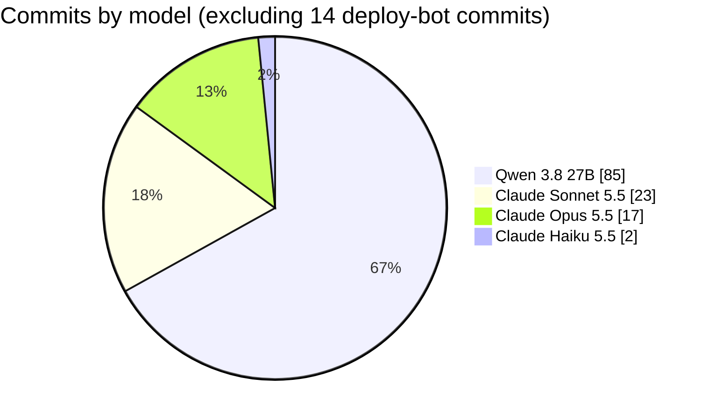

# Appendix B — numbers

All from `git log` on branch `claude/council-fixes` (merged into `main` as
PR #1, merge commit `e9ccb0b`) and the opencode session database. Model =
the commit's `Co-Authored-By` trailer. Line counts exclude the vendored
`js/yaml.js` (3,602 lines), `package-lock.json` and binary files. "Claude
pass" means the 42 fix commits; this case study (`435d135`, Opus) and the
merge commit come on top.

## Commits

| Type | Qwen | Claude pass |
|---|---|---|
| feat | 28 | 3 |
| fix | 6 | 12 |
| docs (mostly plan bookkeeping) | 42 | 18 |
| style | 0 | 4 |
| build / ci / chore / test | 9 | 5 |
| **Total** | **85** | **42** |

- 36 of Qwen's 85 commits (42%) are `docs(plan)` bookkeeping — adding a
  task, checking it off, recording the council.
- Four Qwen `docs(plan)` check-offs also carried code/CSS/test changes
  (`15630bd`, `72b7cba`, `cba8805`, `72645c6`).
- One history rewrite in the whole project: Qwen amended `900becc` →
  `35e2b32` to add a missing 🤖.

## Time

| Phase | Span |
|---|---|
| opencode setup (skills, plugins, status bar) | Oct 9 23:34 → Oct 10 00:30 (+ later fixes) |
| Brainstorm → spec → plan | Oct 10 10:51 (first prompt), 19:39 → Oct 11 03:00 |
| Tasks 1–7 (MVP) | Oct 11 03:00 → 05:43 (163 min) |
| Rest of Qwen's build | Oct 11 10:16 → Oct 14 08:18 |
| Claude review (council + Chrome checks) | Oct 14 ~08:20 → 08:44 |
| Claude fixes (Tasks 14–23 + final wave) | Oct 14 08:44 → 13:19 |
| Case study committed (`435d135`) | Oct 14 13:30 |
| Merged (PR #1) + gated deploy + live smoke test | Oct 14 16:25 |

## Code size at the end of each phase

| File | Qwen final (`f603230`) | After Claude |
|---|---|---|
| `js/app.js` | 242 | 536 |
| `js/question.js` | 329 | 409 |
| `js/board.js` | 101 | 131 |
| `js/folder.js` | 185 | 209 |
| `js/validate.js` | 95 | 142 |
| `js/scoring.js` | 30 | 55 |
| `js/teams.js` | 38 | 38 |
| `js/persist.js` | — | 177 |
| `styles.css` | 157 | 280 |
| `index.html` | 87 | 127 |
| Tests (files / assertion calls) | 4 / 70 | 5 / 214 |
| Browser test | — | `tools/smoke.mjs` (`make smoke`) |

## The opencode sessions (Qwen)

| | |
|---|---|
| Sessions in this project | 2 top-level (setup S1, build S2) + 43 council subagent sessions |
| Partner prompts | 75 (15 setup, 60 build) |
| Tool calls | 1,471 — shell 534, edit 313, read 297, Playwright via Code Mode 156 |
| Context compactions | 11 |
| Responses truncated at the served context limit (163,840) | 15 (11 mid-tool-call) |
| `image input is not supported` errors | 6, over ~3.5 hours |
| Code Mode / Playwright soft errors | 38 |
| Skill tool calls (of 118 skills listed) | 9 |
| Output speed (median, build session) | 19.3 tokens/s |
| Prompt tokens (fresh / served from cache) | 22.3M / 65.6M |
| Output tokens | 1.14M |
| Reasoning words : visible reply words | ~28 : 1 |
| Explicit apologies | 2 |

## Defects, by who found them

| Found by | Count | Examples |
|---|---|---|
| Qwen's own councils (Oct 11–13) | ~12 fixed | per-team tally, state leaking across bank loads, CSS specificity, vacuous test, 871 px setup |
| The partner | 3 | missing trivia Reveal (re-asked), image-error loop ("your council review should've picked up"), status-bar regression |
| Claude review council + Chrome (Oct 14) | ~35 | 7 wrong + 6 shaky answers, 2 Create-new bugs, no persistence, unguarded reset, layout overflow, audio stopping, D-pad, infra |
| Claude's per-task forward reviewers (on Claude's own fixes) | 9 | single save slot (critical), error-list cap, question text shrink, LAN repo exposure, non-unique answer, … |
| Claude's final whole-branch review | 5 | held-OK bypassing the lock, hidden other-board hint, boot note vs reduced motion, spec drift, dead CSS |
